```
                              .-----.       
   .----------------------.   | === |       
   |.-""""""""""""""""""-.|   |-----|       
   ||                    ||   | === |       
   ||                    ||   |-----|       
   ||                    ||   | === |       
   ||                    ||   |-----|       
   || -- Normal --       ||   |:::::|       
   |'-..................-'|   |____o|       
   `"")----------------(""`   ___________   
  /::::::::::|  |::::::::::\  \ no mouse \  
 /:::========|  |==hjkl==:::\  \ required \ 
'""""""""""""'  '""""""""""""'  '""""""""""'
```

In the process of migrating to a self-hosted git instance

- 👋 Hi, I’m @ironlungx
- 👀 I’m interested in c/cpp, linux and mathematics
- 🎗️ Stuff I'm learning and enjoy
    - 📓 Neovim
    - 🚀 NixOS
    - ⌨️ Split keyboards (crkbd)
    - 🧩 QMK




